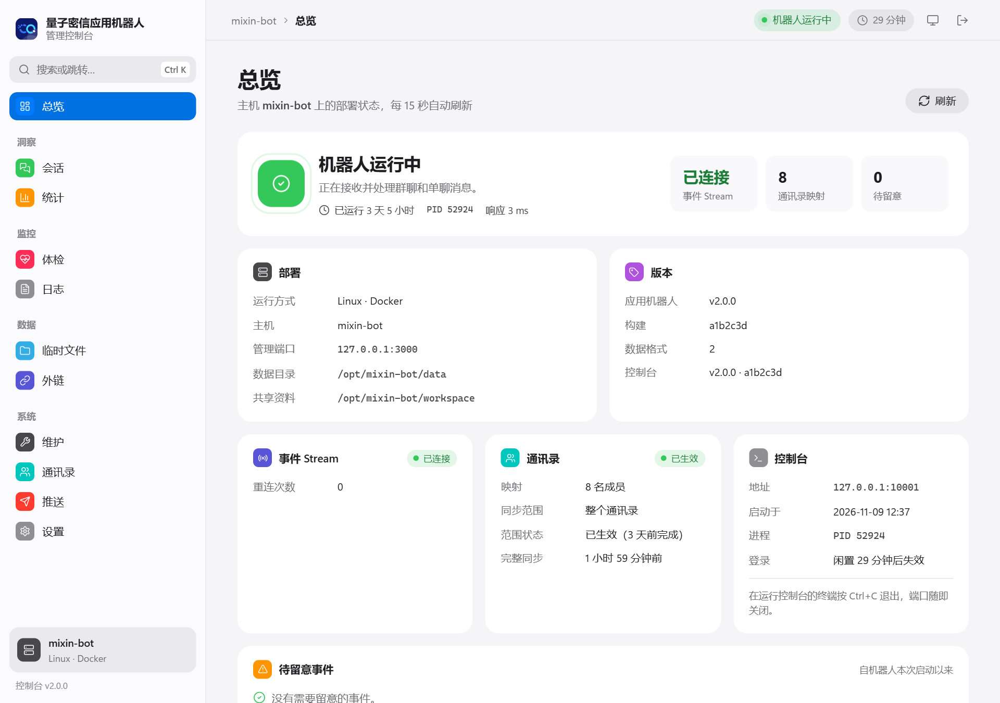
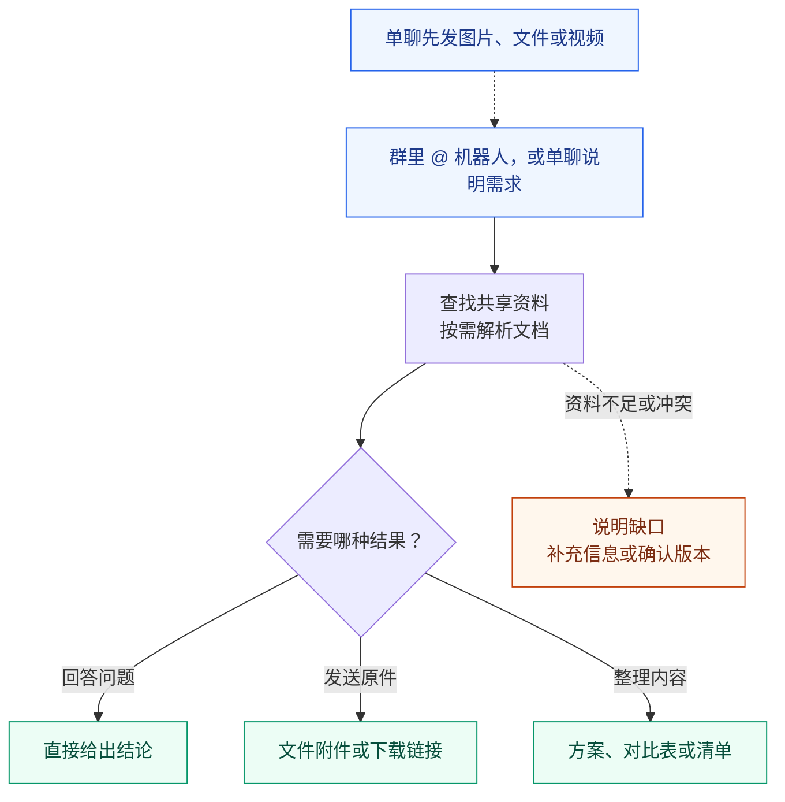
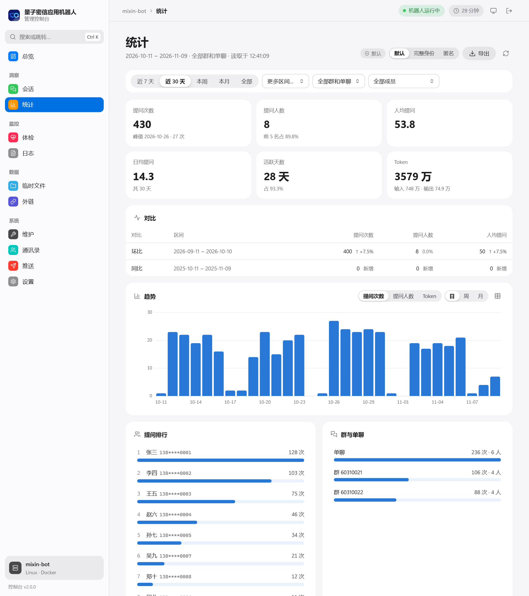
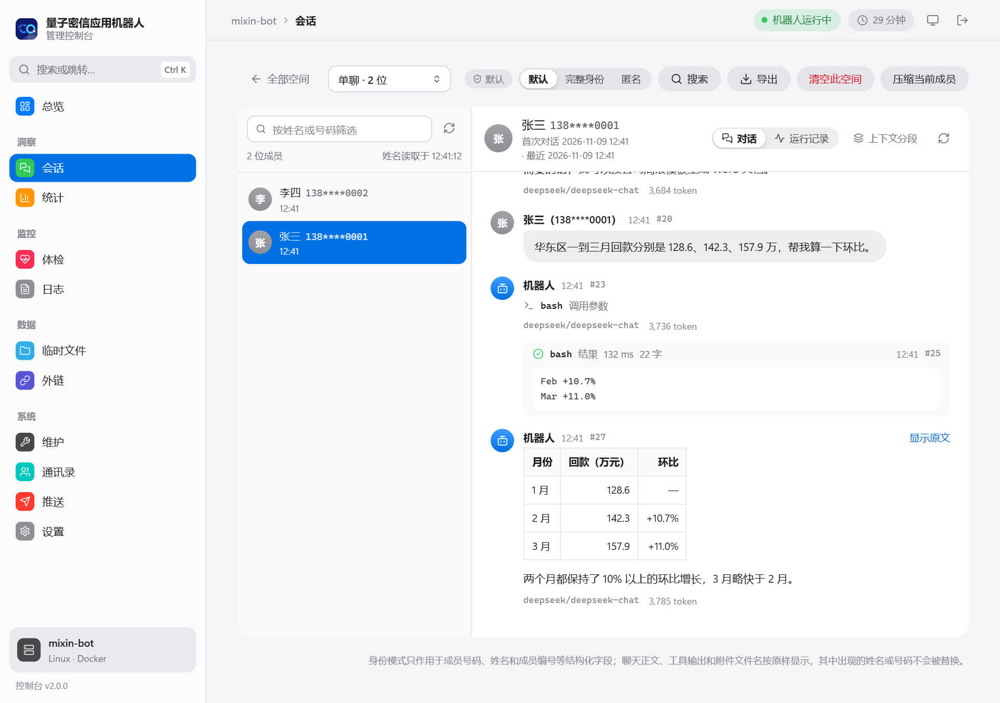
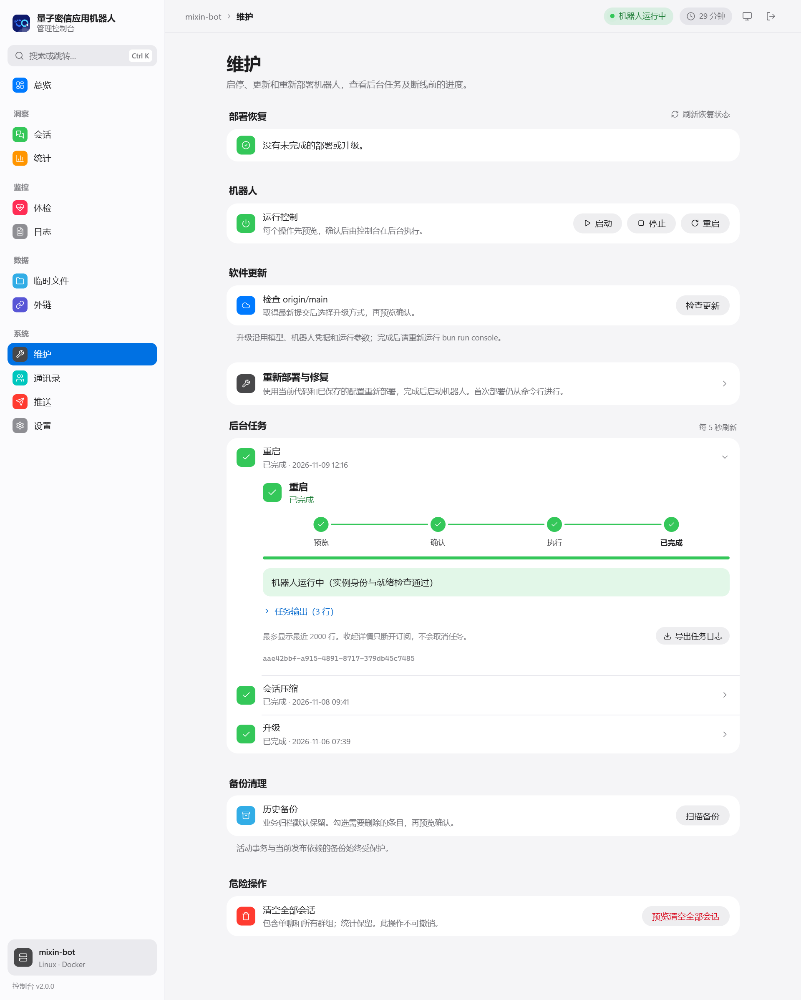

# mixin-bot

面向中国电信量子密信的 AI Agent 应用机器人：在群里 **@ 机器人**或在应用机器人里**直接单聊**，说明需求，它会查找共享资料、调用工具，把回答或生成的文件发回原来的会话。

默认是一个产品资料助手，带文档加工能力：查询产品、发送原件、修改 Word、选编 PPT、按模板生成方案、制作对比表，适用于售前、交付和售后的文档工作。换一份提示词和资料，就是别的用途的助手。

[特点](#特点) · [可以做什么](#可以做什么) · [快速开始](#快速开始) · [使用](#使用) · [日常管理](#日常管理) · [版本与升级](#版本与升级) · [详细文档](#详细文档)

⭐ 如果这个项目对你有帮助，欢迎点一个 Star 支持。



## 特点

- **不需要公网入口**：以开放平台**应用机器人**接入，经事件 Stream 主动连出接收消息；服务器不用开放入站端口，也不用域名或隧道。
- **群聊和单聊**：群里 @ 机器人提问，单聊还能发图片、文件和视频让它处理；每个人在每个群和单聊里各有独立的会话。
- **资料问答与文档加工**：在共享资料目录里查找并注明来源，发送原件，修改 Word、选编 PPT、按模板生成新文档，生成后渲染检查版式。
- **推送与收集**：推送人用一句话把通知发给个人、部门、全员或群，接收人在卡片上确认收到或选择，要回复的直接把内容发给机器人，也可以转给别人处理，到期自动汇总。
- **网页控制台**：首次部署、升级、体检、统计、会话、通讯录、推送和设置都在本机网页里完成，不用记命令。
- **三种部署方式**：Windows 原生、Linux Docker、macOS 原生（实验性支持）。Linux Docker 把 bash 和文档处理放在没有网络的一次性任务容器里运行。

项目面向可信的内部成员：Windows 和 macOS 原生部署不隔离 `bash` 工具，它拥有服务运行账户的系统权限。各部署方式的边界见[提示词与工具](docs/development.md#提示词与工具)和[任务隔离部署](docs/deployment.md#任务隔离部署)。

## 可以做什么

| 需求 | 可以这样问 |
| --- | --- |
| 查资料 | “X 产品支持哪些部署方式？请注明资料来源。” |
| 拿原件 | “把 X 产品当前正式版的手册原文件发给我。” |
| 做对比 | “对比 X 和 Y 的功能、部署方式及限制，生成 Excel 表。” |
| 整理方案 | “根据资料整理项目 A 的方案，生成 Word 文件，列出待确认项。” |
| 修改底稿 | “按最新产品资料更新这份交付方案的部署条件，保留原版式。” |
| 选编 PPT | “从已有产品 PPT 中挑页、修改客户名称并补充部署建议，组装客户方案。” |
| 处理自己的文件（单聊） | 先发文件或截图，再说“总结这份文件，列出与产品资料不一致的地方。” |
| 推送通知、收集回复（推送人，单聊） | “给技术部推送：周五前提交机房盘点清单，需要回复，抄送王五。” |
| 查通讯录（推送人，单聊） | “华东分公司有哪些人？”“张三的手机号是多少？” |



修改 [prompt.ts](src/agent/prompt.ts) 可调整机器人的用途，文档能力见[开发指南](docs/development.md#文档加工)。

## 快速开始

四步：准备环境，启动控制台，在控制台里完成首次部署，接入开发者后台并验证。

### 1. 准备环境

选择与服务器对应的部署方式：

| 部署方式 | 需要准备 |
| --- | --- |
| Windows 原生 | Bun 1.4.4+、Git for Windows（含 GNU Bash）、原生 `uv.exe`；在管理员 PowerShell 中启动控制台 |
| Linux / Docker | glibc Linux、Git、Bun 1.4.4+、Docker Engine、Bash、curl、coreutils、util-linux（`flock`、`setpriv`）；rootful Docker 由 root 启动控制台（docker 组普通用户会被拒绝），rootless Docker 由其所属用户启动 |
| macOS 原生（实验性支持） | Apple 芯片的 macOS 15 或 26；用 Homebrew 安装的 Bun 1.4.4+、bash、coreutils、uv，以及 Git；用 sudo 启动控制台 |

部署和日常管理都在网页控制台里完成，控制台用宿主机的 Bun 运行。Docker 镜像已包含应用运行环境和文档解析依赖。rootful Docker 下控制台以 root 运行，Bun 要装在 root 和项目目录属主都能执行的位置（例如 `/usr/local/bin`）。Linux 需要可访问 `/proc`，不支持 Alpine/musl。Linux 还需要一个本机 rootless Docker daemon，用来隔离执行 bash 和文档处理：rootless 部署复用自己的 daemon，rootful 部署需要一个属于 UID 1001 的 rootless daemon（socket 默认在 `/run/user/1001/docker.sock`）；部署只检查、不代为安装，见[任务隔离部署](docs/deployment.md#任务隔离部署)。macOS 的检出位置、服务账户和限制见 [macOS 原生部署](docs/deployment.md#macos-原生部署实验性支持)。安装链接见[选择部署方式](docs/deployment.md#选择部署方式)。

同时准备：

- **模型账号**：API Key 和要使用的模型；自定义接口还需接口地址和协议。
- **应用机器人**：在量子密信开发者后台创建企业自建应用、启用机器人能力，记下 AppID 和 AppSecret，并授予收发消息、临时文件和通讯录读取权限（最小权限见[应用机器人](docs/deployment.md#应用机器人)）。通讯录可见范围要覆盖所有会使用机器人的成员。
- **出站网络**：服务器能以 HTTPS（443 端口）访问 `imtwo.zdxlz.com` 和 `imfl.zdxlz.com`。

### 2. 获取代码并启动控制台

```sh
git clone https://github.com/jaykwok/mixin-bot.git
cd mixin-bot
```

请在**新的空目录**部署，不要在更早版本的部署目录上部署。macOS（实验性支持）把检出放在服务账户能读取的目录，例如 `/opt/mixin-bot`。在项目目录启动网页控制台：

**Windows**（管理员 PowerShell）：

```powershell
bun run console
```

**Linux / Docker**：rootful Docker（默认安装）用 root 启动，rootless Docker 由其所属用户启动：

```sh
sudo bun run console    # rootful Docker
bun run console         # rootless Docker
```

**macOS**：

```sh
sudo bun run console
```

Windows 和 macOS 自动打开浏览器；Linux 打印 SSH 转发命令和一次性登录链接，在自己电脑的浏览器打开，见[通过 SSH 访问](docs/console.md#通过-ssh-访问)。

### 3. 在控制台完成首次部署

总览显示“尚未部署”，点「开始首次部署」，在维护页按向导操作：

1. **检查本机环境**：缺少依赖时点「安装依赖」，再点「开始检查」，按说明处理未通过的项。
2. **应用机器人凭据**：填写 AppID 和 AppSecret，在线校验能取得访问令牌。
3. **模型**：选择服务商和模型，填写凭据并校验（核对配置和凭据引用，不发起模型推理；能否回答在第 4 步验证）。
4. **通讯录同步范围**：整个通讯录，或逐层勾选部门。
5. **端口与共享资料**：机器人端口默认 `10000`；共享资料默认放在项目目录下的 `workspace/`，也可以选已有的外置目录（服务只读）。
6. **预览并部署**：核对预览中的步骤后确认。部署在后台运行，关掉网页不会取消；完成后总览显示机器人运行状态。

部署前会在目标运行环境（Linux 的候选镜像、macOS 的服务账户）里再完整检查一次，不通过就不部署；部署在提交前失败会自动撤销本次的改动，不留下服务，被中断时在维护页继续或回滚。大文件外链可稍后在「设置」中配置。各项配置说明见[部署与配置](docs/deployment.md)。

### 4. 接入开发者后台并验证

1. 服务启动后，在开发者后台的事件订阅中选择 **Stream**，点「验证连接」（服务必须已在运行）并保存，勾选机器人接收消息事件和卡片交互事件（推送卡片的按钮需要）并保存，再在「版本管理」提交并发布版本，事件才生效。步骤见[接入开发者后台](docs/deployment.md#接入开发者后台)。
2. 在控制台「体检」页检查配置、服务、事件 Stream 和通讯录同步。首次通讯录同步在后台进行，进度见「通讯录」页；完成前未同步到的成员会收到“正在同步通讯录”的提示。
3. **验证群聊**：在客户端把应用机器人加入测试群，@ 机器人发送“只回复 OK”，确认能收到回答。
4. **验证单聊**：在应用机器人里发一条消息，再发一张图片或一个文件，确认机器人回复“…收到了，想让我怎么处理？”。
5. 把资料同步到共享资料目录，再请求查找资料、发送文件，并试一下 `/status`、`/stop`。目录结构与备份见[数据目录](docs/deployment.md#数据目录)。

本地健康检查只表示应用已就绪；在群里和单聊里都收到回复和文件，才算完成实际验证。遇到问题先看[运维手册](docs/operations.md)。

## 使用

说明产品或项目名称、版本要求和输出格式即可。同一用户的请求按顺序处理，最多 8 条排队，等待时可以查询进度或取消。完整行为见[使用指南](docs/usage.md)。

### 群聊与单聊

两种会话共用同一份资料目录和同一套指令，区别在于怎么提问、能发什么：

| | 群聊 | 单聊 |
| --- | --- | --- |
| 怎么提问 | 必须 @ 机器人（指令也要 @），否则机器人收不到 | 直接发送 |
| 能发给机器人的内容 | **只支持文字**（含引用回复）；发图片、文件或视频会提示改到单聊发送 | 文字（含引用回复）、**图片、文件和视频** |
| 机器人发回的内容 | 文字回答，以及生成或查到的文件 | 同群聊 |
| 回复格式 | 开头一行“> 回复 姓名：提问摘要”，最终结果会 @ 提问人 | 直接回复 |
| 会话 | 每人在每个群里各有一个独立会话 | 每人一个独立会话 |

- 会话按空间隔离：全部单聊共用一个空间，每个群一个空间；每位成员在各空间中有独立的会话和临时文件，`/clear` 只影响自己在当前群或单聊的对话。
- 机器人按通讯录识别成员（以手机号归属会话和统计）。刚部署或刚加入通讯录时可能提示“正在同步通讯录”，稍后重发即可。
- 语音等其他消息类型暂不支持。

### 指令

| 指令 | 用途 |
| --- | --- |
| `/status` | 查看当前进度、排队情况和正在运行的工具 |
| `/stop` | 取消当前任务并清空等待消息 |
| `/clear` | 取消任务，在当前群或单聊开始新会话（旧会话留在空间库里） |
| `/compact` | 为本人在当前群或单聊生成上下文摘要，保留历史记录；会产生模型用量 |
| `/help` | 查看指令说明 |
| `/登记群 群名` | 推送管理员在群里登记这个群，之后可以推送到群 |

### 推送

管理员在控制台「推送」页指定推送人，按需授权推送给部门、全员或已登记的群，名单为空时没有人能推送。推送人在单聊里说明推送内容，机器人先发预览卡片，推送人点「确认推送」才会发出。推送有三种要求：

| 要求 | 接收人的卡片 | 汇总 |
| --- | --- | --- |
| 确认收到（通知） | 一个「已收到」按钮 | 谁确认了、确认时间、未确认名单 |
| 选项 | 每个选项一个按钮（2 到 6 个） | 每人的选择 |
| 需要回复（收集） | 不用点按钮，直接把文字或附件发给机器人；要改、要撤回也直接说 | 每人的回复原文和附件 |

不知道对方手机号时说姓名或部门即可，机器人查通讯录列出候选人，由推送人指定；推送人平时也可以让机器人查某人的手机号或部门。接收人觉得该由别人处理时，告诉机器人转给谁，确认后推送转给对方，推送人会收到通知。截止时或全部答复后，汇总发给推送人和抄送人。群推送、转派、补推送等细节见[使用指南](docs/usage.md#推送)。

### 发文件给机器人（仅单聊）

在单聊中把图片、文件或视频发给机器人，它会回复“…收到了，想让我怎么处理？”并在后台下载；接着发一条文字说明要做什么。这条请求会带上之前收到、还没用过的全部附件。

- 项目不限制收取的文件大小，以平台和服务器磁盘为准；下载失败时会说明原因。
- 每人最多保留 10 个还没用过的附件，24 小时内没有被请求用到的会作废。
- 模型支持图像时，机器人可以直接查看图片。
- 群聊里不能发文件给机器人；需要处理自己的文件时请改用单聊。

### 机器人发回的文件（群聊和单聊）

- 不超过 **30 MiB** 的文件直接作为附件发送。
- 更大的文件需要管理员[配置外链](docs/operations.md#配置可选的大文件外链)（可选），以下载链接发送，默认分发上限 **2 GiB**，链接默认 2 小时有效。
- 回复或文件被平台拒收时，机器人会自动重发，6 小时内仍发不出才放弃；发送结果不确定（平台可能已收到）的内容不重发，以免重复。

服务重启或升级期间发出的消息，平台约 5 分钟后补推，机器人照常处理；停机超过 5 分钟时，期间的消息可能收不到，需要重发。

## 日常管理

日常管理同样在网页控制台里进行，启动方式与首次部署时相同（Windows 用管理员 PowerShell，rootful Docker 和 macOS 用 sudo）：

```sh
bun run console
```

Windows 和 macOS 自动打开浏览器；Linux 打印 SSH 转发命令和一次性登录链接。控制台只监听本机，机器人停止时也能使用；需要时启动，用完在终端按 Ctrl+C 退出。

| 统计 | 会话 | 维护 |
| --- | --- | --- |
|  |  |  |

截图使用演示数据。

| 想做什么 | 在哪里操作 |
| --- | --- |
| 检查故障、查看日志 | 体检 / 日志 |
| 查看用量、导出离线 HTML 报表或 CSV | 统计 |
| 查看会话，清空或压缩上下文（清空相当于成员发送 `/clear`，不影响使用统计） | 会话；清空全部会话在维护页 |
| 接管对话：停下机器人的回答，以机器人的名义回复成员 | 会话 |
| 清理临时文件，测试和清理外链 | 临时文件 / 外链 |
| 启停、升级、重新部署或修复，查看后台任务；卸载 | 维护 |
| 查看 Stream 与通讯录同步、选择同步范围 | 通讯录 |
| 设置推送人与授权，查看推送记录、补推送、下载汇总包，登记群 | 推送 |
| 修改模型、应用机器人凭据、外链和运行参数 | 设置 |

总览显示正在运行的版本、构建、数据格式和待处理事项。登录、SSH 访问、身份模式与导出见[网页控制台](docs/console.md)。

控制台的管理操作由与命令行共用的运维核心执行。脚本调用或排障时可以直接使用命令行入口 `scripts/ops.ps1`、`scripts/ops.sh`，见[命令行运维](docs/operations.md#命令行运维)。

## 版本与升级

版本分三项：程序版本（当前 2.0.0）、数据格式（当前 4）和构建（Git 提交）。部署记录 `data/state/data-version.json` 写明实际部署的版本，并绑定部署时的应用；升级按它判断，数据格式一致才升级，没有有效记录的目录拒绝原地安装或升级。升级在控制台维护页进行。规则见[版本、数据格式与从旧版切换](docs/data-migrations.md)。

> **从 v1.x 或更早的 webhook 版本过来：** 这些版本**不能升级**到 2.0.0，请在新目录全新部署。会话、资料目录和配置都不迁移；v1.x 统计的提问数和 token 用量可以恢复到新部署的空账本。步骤见[从更早的版本切换](docs/data-migrations.md#从更早的版本切换)。

## 详细文档

| 文档 | 适合什么时候看 |
| --- | --- |
| [部署与配置](docs/deployment.md) | 安装部署、选择模型、查配置项、同步资料和备份数据 |
| [使用指南](docs/usage.md) | 群聊与单聊的提问方式、指令、发文件给机器人、文件交付和推送 |
| [网页控制台](docs/console.md) | 启动与登录、首次部署与卸载、各页面用途、身份模式与导出、管理任务与恢复 |
| [运维手册](docs/operations.md) | 命令行管理、排查故障、通讯录同步、配置外链 |
| [运行设置与可选工具](docs/runtime-tools.md) | 调整 Pi 的运行设置，配置辅助模型和 MCP 工具 |
| [版本与从旧版切换](docs/data-migrations.md) | 版本、数据格式与应用绑定规则，以后的升级边界，从更早的版本切换与恢复统计 |
| [开发指南](docs/development.md) | 理解架构、修改提示词与工具、了解文档加工能力、运行开发检查 |

基于 Bun、Hono 和 Pi（Durable 引擎，全部单聊一个、每个群一个 SQLite 空间库）。

## 许可

本项目以 [Apache License 2.0](LICENSE) 发布。

## 反馈与支持

使用中遇到问题或有改进建议，欢迎提 [Issue](https://github.com/jaykwok/mixin-bot/issues)。

如果你喜欢这个项目，请点一个 ⭐ Star：这是对作者最直接的鼓励，也能让更多人看到它。
